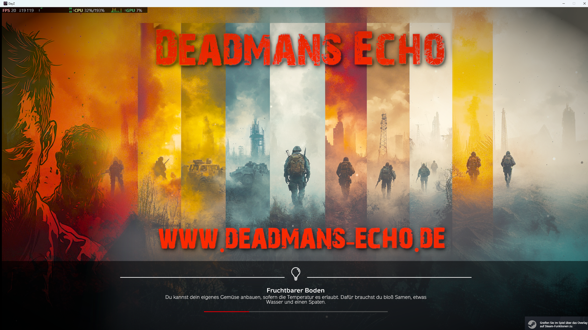
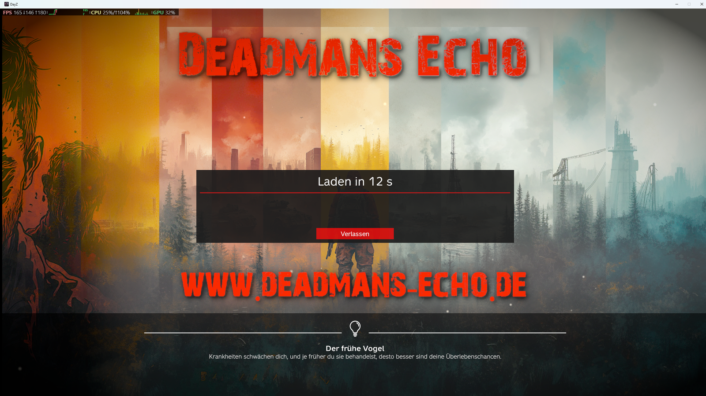

# FixedLoadingScreen ablösen

Psyerns Interactive Loadingscreen ersetzt den alten `FixedLoadingScreen`-Mod vollständig.
Die aktive Konfiguration (`Data/psy_ils_config.json`) ist das Preset **Deadmans Echo**.

## Was übernommen wurde

| FixedLoadingScreen | Interactive Loadingscreen |
|---|---|
| `DME1.edds` als Loadingscreen | `Layers` – DME1, in 4 Parallax-Ebenen zerlegt |
| `DME2.edds` im Login-Countdown | `LoginTimeLayers` – DME2, 4 Ebenen |
| `DME3.edds` in der Warteschlange | `LoginQueueLayers` – DME3, 4 Ebenen |
| DayZ-Logo ausgeblendet | `"HideDayZLogo": true` |
| Hinweis „modifizierte Version" ausgeblendet | `"HideModdedWarning": true` |
| Menümusik `DME1.ogg`, `Alone.ogg`, `DME1alt.ogg` | `"MenuMusicSoundSets": ["PSY_ILS_DME_Menu_SoundSet"]`, gleiche drei Tracks |
| `ls_mask.paa` (Maske, existierte im Mod nicht) | entfällt |

Neu dazu: Maus-Parallax, Rauch, Glut in zwei Tiefen, Cursor-Licht, Vignette, Idle-Drift.




Animierte Vorschau der Ebenen: [DME1](previews/psy_ils_dme1_parallax.gif) · [DME2](previews/psy_ils_dme2_parallax.gif) · [DME3](previews/psy_ils_dme3_parallax.gif)

## Aus flachem Bild wird Tiefe

`tools/psy_ils_build_dme_preset.py` zerlegt jedes Artwork automatisch:

| Ebene | Inhalt | Depth |
|---|---|---|
| `bg` | ganzes Bild, Schriftzug herausretuschiert (spaltenweise gespiegelt aufgefüllt – erhält die vertikalen Streifen), unter Boden/Gesicht weichgezeichnet | 0.06 |
| Rauch | dunkles Rauchband, pendelt | 0.3 |
| `ground` | dunkler unterer Bildteil mit weicher Oberkante | 0.5 |
| `face` | Silhouetten-Band am linken (DME1/2) bzw. rechten (DME3) Rand | 0.8 |
| `text` | „DEADMANS ECHO" + URL per Farbmaske freigestellt, mit Schlagschatten, `NoOverscan` | 0.3 |

Der Schriftzug liegt bewusst nah an der Hintergrundebene (0.3): Er bleibt immer vollständig sichtbar und
lesbar, und die retuschierte Stelle darunter wird nie freigelegt. Die starke Tiefe liefern Boden und Gesichter.

Neu erzeugen (z. B. nach neuen Artworks gleichen Layouts):

```
python Psyerns_Interactive_Loadingscreen_Doks/tools/psy_ils_build_dme_preset.py "C:/Pfad/zu/FixedLoadingScreen/data"
```

Die Schrift-Boxen (`TEXT_BOXES`) und Bandbreiten oben im Skript passen auf das DME-Template (1456×816);
für Artworks mit anderem Aufbau dort anpassen.

## Umstellung auf dem Server

1. `FixedLoadingScreen` aus `-mod=` entfernen, `@Psyerns_Interactive_Loadingscreen` eintragen (Client-Inhalt → `-mod=`, nicht `-serverMod`).
2. `.bikey` des neuen Mods in `keys\` legen, alten Key optional entfernen.
3. Spieler laden den neuen Mod über den Launcher / Workshop.

Laufen versehentlich beide Mods: Das Bild von FixedLoadingScreen landet im ausgeblendeten Vanilla-Hintergrund
und bleibt unsichtbar; die Menümusik setzt der Interactive Loadingscreen nach allen anderen Registrierungen
(`PreloadData`-Hook) – sichtbar und hörbar ist also in jedem Fall der neue Mod.

## Zurück zur neutralen Szene

`Data/presets/psy_ils_dusk.json` nach `Data/psy_ils_config.json` kopieren und neu packen –
oder zum Testen nach `<Client-Profil>/Psyerns_Interactive_Loadingscreen/psy_ils_config.json`.
