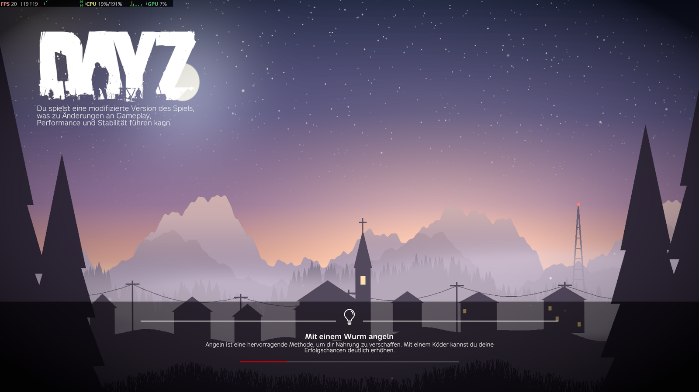

# Psyerns Interactive Loadingscreen – Dokumentation

Ein interaktiver Loadingscreen für DayZ: Die Szene besteht aus mehreren Ebenen
(Himmel, Berge, Wald, Nebel, Dorf, Vordergrund, Vignette), die sich je nach
Tiefe unterschiedlich stark gegen die Mausbewegung verschieben. Dadurch wirkt
das flache Bild dreidimensional (Parallax). Dazu kommen schwebende Glut-/Staubpartikel
auf zwei Tiefen und ein weiches Licht, das dem Cursor folgt.


## Wo es aktiv ist

| Screen | Vanilla-Klasse | Wann |
|---|---|---|
| Loadingscreen | `LoadingScreen` (3_Game) | Spielstart, Server-Join, Map-Ladevorgang |
| Login-Countdown | `LoginTimeBase` | „Lade in X Sekunden" nach dem Connect / Respawn |
| Warteschlange | `LoginQueueBase` | Queue-Position bei vollem Server |

Die Szene ersetzt jeweils nur das Vanilla-Hintergrundbild (`ImageBackground` bzw. `Background`)
und liegt **hinter** allen Vanilla-Widgets – Ladebalken, Tipps, Countdown und der
„Verlassen"-Button funktionieren unverändert.

## Effekte

- **Parallax:** Jede Ebene hat eine Tiefe (`Depth`, 0 = statisch, 1 = Vordergrund). Verschiebung = Mausauslenkung × `MaxShift` × Tiefe.
- **Rollen:** Nahe Ebenen kippen leicht mit der horizontalen Mausposition (`MaxRollDeg`) – verstärkt den Kamera-Eindruck.
- **Glättung:** Die Kamera folgt der Maus weich (`MouseSmoothing`), Ladehänger mit riesigen Frame-Zeiten werden abgefangen.
- **Idle-Drift:** Bewegt sich die Maus `IdleDriftAfter` Sekunden nicht (oder ist während eines Ladevorgangs kein Cursor da), schwenkt die Kamera selbstständig langsam in einer Lissajous-Bahn.
- **Atmen:** Ein sehr langsamer Zoom-Puls, je Tiefe stärker (`BreathingScale`).
- **Nebel-Sway:** Einzelne Ebenen können horizontal pendeln (`SwayAmplitude`, `SwaySpeed`).
- **Partikel:** Additiv geblendete Glut-/Staubpunkte steigen auf, flackern und haben eigene Zufallstiefen.
- **Cursor-Licht:** Ein weicher, additiver Lichtkegel folgt dem Cursor (beim Idle-Drift gedimmt).

## Getestet

DayZ 1.30 (DayZDiag), 2560×1440: Compile ohne Fehler/Warnungen aus dem Mod, Szene im Loadingscreen beim
Spielstart (Standbild, siehe [TECHNICAL.md](TECHNICAL.md)) und beim Server-Join animiert, Join bis ins Spiel ohne Fehler.



## Installation

1. PBO bauen (siehe [BUILD.md](BUILD.md)) oder fertiges `@Psyerns_Interactive_Loadingscreen` verwenden.
2. Mod in **`-mod=`** laden (Client-Inhalt!), nicht `-serverMod`. Server und Clients brauchen den Mod.
3. `.bikey` in den `keys`-Ordner des Servers legen, wenn das PBO signiert wird.

Der Mod ist reiner Client-Code (nur `3_Game`), hat keine Abhängigkeiten (kein CF, kein Expansion)
und schickt keine RPCs.

> Der Loadingscreen beim **allerersten** Spielstart erscheint nur, wenn der Mod im Launcher geladen ist –
> das ist bei jedem Loadingscreen-Mod so, weil der Screen gebaut wird, bevor ein Server bekannt ist.

## Weitere Doku

- [CONFIGURATION.md](CONFIGURATION.md) – alle JSON-Optionen
- [CUSTOM_LAYERS.md](CUSTOM_LAYERS.md) – eigene Ebenen/Artwork einbauen (z. B. Server-Branding)
- [BUILD.md](BUILD.md) – PBO bauen, Texturen neu generieren
- [TECHNICAL.md](TECHNICAL.md) – wie der Mod intern funktioniert

## Ordnerstruktur

```
Psyerns_Interactive_Loadingscreen/            ← Git-Repo
├── Psyerns_Interactive_Loadingscreen/        ← PBO-Quelle (Prefix: Psyerns_Interactive_Loadingscreen)
│   ├── $PBOPREFIX$, config.cpp, mod.cpp
│   ├── Data/psy_ils_config.json              ← Standard-Konfiguration
│   ├── gui/layouts/                          ← Szene- und Ebenen-Templates
│   ├── gui/textures/                         ← Ebenen als .edds (Power-of-Two)
│   └── Scripts/3_Game/Psyerns_Interactive_Loadingscreen/
│       ├── PSY_ILS_Config.c                  ← JSON-Datenklassen + Laden/Validieren
│       ├── PSY_ILS_Scene.c                   ← Parallax-Engine
│       └── PSY_ILS_LoadingScreen.c           ← Hooks in LoadingScreen / Login-Screens
└── Psyerns_Interactive_Loadingscreen_Doks/   ← diese Doku
    ├── previews/                             ← PNG-Vorschau jeder Ebene
    └── tools/                                ← Textur-Generator, Build-Skript
```
